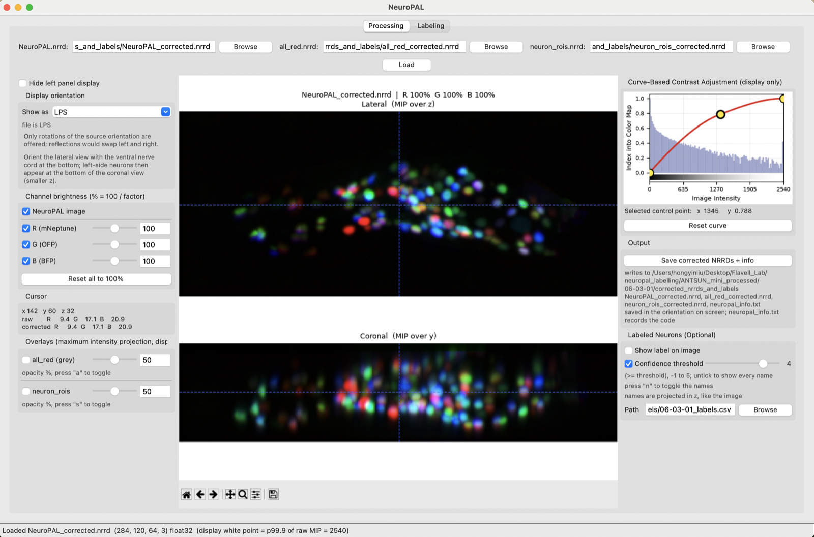
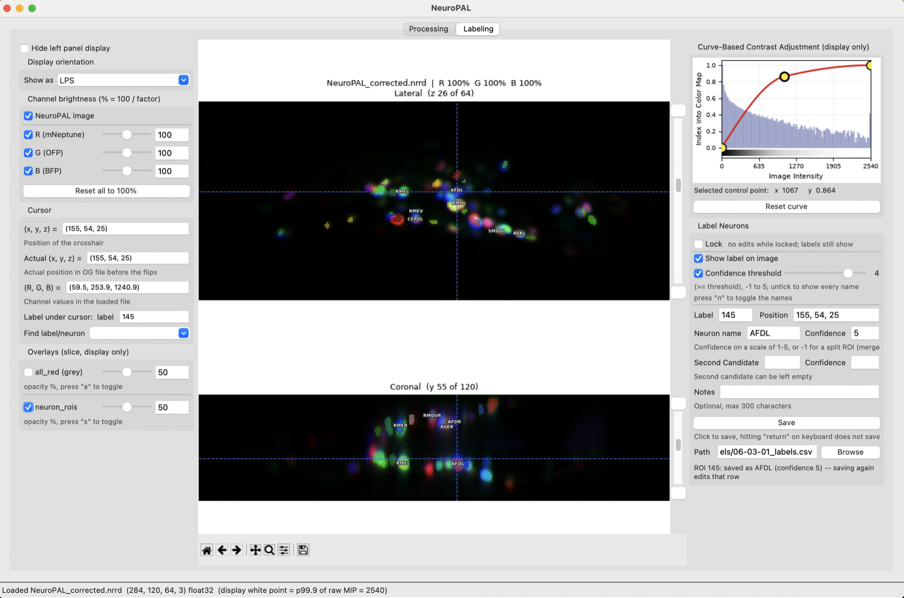
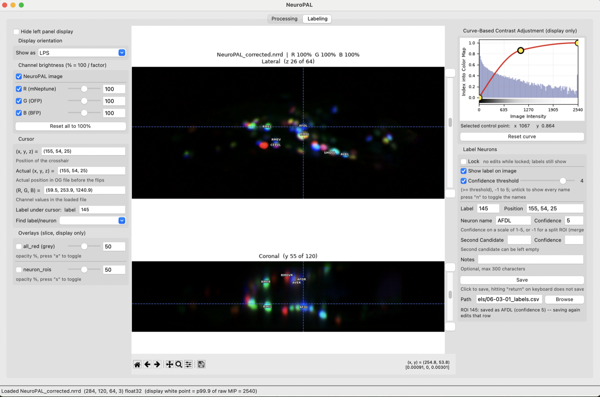

# NeuroPAL GUI

An interactive viewer for NeuroPAL volumes with two jobs: balance the colour channels of a
multichannel `.nrrd`, and identify neurons ROI by ROI into a label table. Both tabs work on
the same loaded volume and show a lateral and a coronal panel with a linked crosshair.

3-minute tutorial video/demo: [demo-tutorial-youtube-3min](https://youtu.be/dGFeFBPVXT4)

Built on Tk + matplotlib; volumes are read and written with `pynrrd`.

Every command below is run from inside that `neuropal-gui` folder.

## Download, Install and Run
Download the repository
```bash
git clone https://github.com/flavell-lab/neuropal-gui.git
cd neuropal-gui
```

With [uv](https://docs.astral.sh/uv/) (recommended — the Python it downloads includes Tk).
If you do not have uv, install it with `curl -LsSf https://astral.sh/uv/install.sh | sh` on
macOS or Linux, or see its [install page](https://docs.astral.sh/uv/getting-started/installation/)
for Windows. Then:

```bash
uv sync
uv run run_neuropal_gui_example.py
```

Or with an existing Python 3.10+ that has `tkinter`:

```bash
pip install matplotlib numpy pynrrd scipy
python3 run_neuropal_gui_example.py
```

This opens the bundled example dataset in `2023-01-06-08/`. To use your own data, edit the
paths at the top of `run_neuropal_gui_example.py`, or leave them and use the **Browse**
boxes in the Processing tab.

## Workflow

Two passes over a dataset:

1. **Processing** — set the display orientation and the per-channel brightness, then save.
   The orientation and the brightness are baked into the written volumes.
2. **Labeling** — reopen the corrected volumes and name neurons. Positions are recorded in the loaded file's own coordinates.

## Processing tab



Top row: paths to `NeuroPAL.nrrd` and its companions `all_red.nrrd` and `neuron_rois.nrrd`,
then **Load**. Both panels are maximum intensity projections — lateral over z, coronal
over y.

- **Display orientation** — pick the anatomical code (LPS, RAS, …) the volume should be
  shown in. Only rotations of the file's own orientation are offered; reflections would
  swap left and right. Aim for the ventral nerve cord at the bottom of the lateral view,
  which puts left-side neurons at the bottom of the coronal view.
- **Channel brightness** — This is essential to get the correct colors for each neuron, e.g. CEPD is pink, AVA is a bright blue color, etc. one slider and box per channel, as a percentage of a division
  factor (100% = untouched, 50% = divided by 2, 200% = multiplied by 2). The checkboxes
  turn a channel, or the whole NeuroPAL image, off in the display.
- **Cursor** — voxel coordinates under the crosshair with the raw and corrected channel
  values. Click or drag either panel to move it.
- **Overlays** — `all_red` as a grey overlay, `neuron_rois` as a colour-coded segmentation,
  each with an opacity box; `a` and `s` toggle them.
- **Curve-Based Contrast Adjustment** — an ITK-SNAP-style transfer curve over the intensity
  histogram. Drag the control points; display only, never written to file.
- **Output** — **Save corrected NRRDs + info** writes, next to the source by default:
  `NeuroPAL_corrected.nrrd` (reoriented and rescaled), `all_red_corrected.nrrd` and
  `neuron_rois_corrected.nrrd` (reoriented only), and `neuropal_info.txt` recording the
  saved orientation and the factors used.
- **Labeled Neurons (Optional)** — draw the names from an existing label table over the
  images, filtered by a confidence threshold (`n` toggles them).

## Labeling tab



Same volume, one z slice at a time instead of a projection, and nothing here can write a
volume. Drag the scrollbars beside each panel to step through z (lateral) and y (coronal).
The left panel repeats the orientation dropdown, the channel brightness and the overlays,
plus a fuller cursor readout:

- **(x, y, z)** — the crosshair position, in the orientation on screen.
- **Actual (x, y, z)** — the same point in the loaded file's own indices, which is what
  gets saved.
- **(R, G, B)** — the channel values at that voxel.
- **Label under cursor** — the `neuron_rois` ROI id under the crosshair.



**Label Neurons**, on the right, records one neuron per ROI:

- **Label** and **Position** fill themselves in from the crosshair.
- **Neuron name**, **Confidence** (1–5, or −1 for a split ROI merged at segmentation),
  an optional **Second Candidate** with its own confidence, and **Notes** (max 300 chars).
- **Save** writes the row — it has to be clicked; pressing Return does not save. Saving an
  ROI again edits its row in place rather than appending a second one.
- **Lock** blocks edits while leaving the names visible; **Show label on image** and the
  **Confidence threshold** control which names are drawn.
- **Path** is the label table, created on the first save as
  `<dataset folder>_labels.csv` in the output folder.

### Finding a neuron


**Find label/neuron** lists every saved label as `<ROI id> <name>`. Pick one off the list,
or type an ROI id or a neuron name and press Return: the crosshair jumps to that ROI's
centroid in both panels, changing the z and y slices as needed.

## Label table

One row per ROI, written as UTF-8 CSV with these columns:

`Neuron Class`, `Coordinates`, `ROI ID`, `Confidence`, `Second Candidate`,
`Second Candidate Confidence`, `Notes`

Named rows come first, sorted by ROI id, then any rows left unidentified. Recall keys are on `ROI ID` (used for displaying neuron names on roi), so `Coordinates` is written for user's reference only.

## Notes

- Runs on macOS, Linux and Windows.
- For data that lives on a server, see [Working with data on a remote machine](#working-with-data-on-a-remote-machine).
- Volumes are `(X, Y, Z, C)` for NeuroPAL and `(X, Y, Z)` for the companion files.

## Working with data on a remote machine

The GUI needs a display, so it runs on your own machine. If the volumes live on a server,
mount that folder over SSH and point a launcher at it -- reads are fast enough that it does
not feel remote, and saves write straight back to the server.

**Set up once.** On macOS (FUSE-T needs no kernel extension, unlike macFUSE):

```bash
brew install --cask fuse-t
brew install --cask macos-fuse-t/cask/fuse-t-sshfs
mkdir -p ~/mnt/server
```

On Linux, `sudo apt install sshfs` (or `sudo dnf install fuse-sshfs`) instead of the casks.

**Then make a launcher for the remote data.** Copy `run_neuropal_gui_example.py` to, say,
`run_neuropal_gui_remote.py`, and set `HOME` to where the dataset will appear under the
mount:

```python
HOME = os.path.expanduser("~/mnt/server/path/to/2023-01-06-08")
```

**Every session, three commands** from the folder holding the launchers:

```bash
sshfs user@server:/home/user ~/mnt/server -o reconnect,volname=server,noappledouble
uv run run_neuropal_gui_remote.py
umount ~/mnt/server
```

Mount, run, unmount. Nothing to edit again unless you switch datasets.

Worth knowing:

- Keep the code and `.venv` on the local disk; only the data belongs on the mount.
  `uv sync` over SSHFS writes thousands of small files and is slow.
- The mount goes stale after sleep or a network change, and the launcher will then say the
  folder is not there. `umount ~/mnt/server` and mount again.
- Do not sleep the machine or drop the connection during a save -- a partially written
  `.nrrd` is unreadable. Interrupting a load is harmless.
- On macOS, `sudo mdutil -i off ~/mnt/server` stops Spotlight indexing the mount over the
  network, and `defaults write com.apple.desktopservices DSDontWriteNetworkStores -bool
  true` stops Finder writing `.DS_Store` files onto the server.

Copying the dataset over with `rsync` and working locally is the zero-install alternative,
and avoids all of the above.

**Running the GUI itself on the server** (X11 forwarding, `ssh -Y`) works, but the server
needs `xauth` installed and `X11Forwarding yes` in `sshd_config`, and every redraw ships a
full bitmap, so dragging the crosshair and scrolling slices lag. A VNC session is better if
the server has one. Both usually need an administrator; the mount above does not.

## License

MIT — see [LICENSE](LICENSE).
